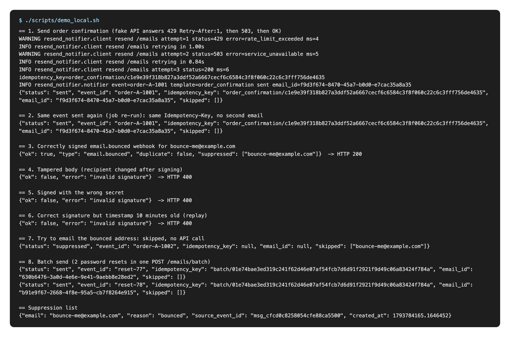
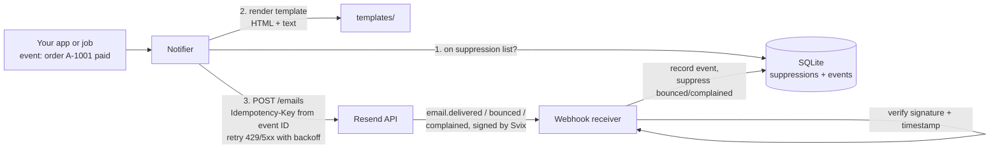

# Resend Email Notifier

Transactional email for an app or automation, sent through the [Resend](https://resend.com) API, built the way production email needs to be: templates with HTML and plain-text parts, no duplicate sends when a job re-runs, sensible retries, signed bounce and complaint webhooks, and a suppression list so the app stops mailing addresses that bounced or complained.

It comes in two forms:

- **A small Python package and CLI** (`resend_notifier`), plus a webhook receiver.
- **Two importable n8n workflows** that do the same job with an HTTP Request node and a Webhook node, for teams that run their automations in n8n.



*The Python version end to end against a local fake Resend API. The n8n workflows were run the same way on a self-hosted n8n ([capture](media/n8n-live-run.png)), and this is the [rendered order email](media/order-email.png).*

## How it works



1. Your code calls `Notifier.send(event_id, template, to, context)` with the ID of the thing that happened (an order, a sign-up, a password reset request).
2. Any recipient on the suppression list is dropped. If nobody is left, nothing is sent and the result says `suppressed`.
3. The template renders a subject, an HTML part and a plain-text part. HTML is autoescaped, so customer data such as a name or a note cannot inject markup. Missing variables raise an error instead of sending a half-filled email.
4. The email goes to `POST https://api.resend.com/emails` with an `Idempotency-Key` derived from the event ID. If the job runs twice, or a retry happens after Resend already accepted the first attempt, Resend returns the original email instead of sending another one. Keys last 24 hours on Resend's side.
5. Resend calls the webhook receiver with delivery events. Each request is verified (Svix signature, 5 minute timestamp window), stored once per `svix-id`, and permanent bounces, complaints and `email.suppressed` events add the address to the suppression list.

## Retry rules

| Response | What happens |
|---|---|
| 2xx | done |
| Network error or timeout | retried with exponential backoff and jitter |
| 429 `rate_limit_exceeded` | retried; waits exactly `Retry-After` when Resend sends it, gives up if it asks for more than 60 s |
| 429 daily or monthly quota exceeded | not retried (`QuotaExceededError`), waiting seconds will not help |
| 409 `concurrent_idempotent_requests` | retried, the first request with that key is still in flight |
| 409 `invalid_idempotent_request` | not retried (`IdempotencyConflictError`), same key used with a different body |
| 5xx | retried with backoff |
| any other 4xx (400, 401, 403, 422) | raised straight away (`ValidationError`), a bad request stays bad |

Backoff is `base * 2^(attempt-1)`, capped, with "equal jitter" (half fixed, half random) so many workers do not retry in step. Every attempt reuses the same idempotency key, so a retry can never produce a second email. After the last attempt you get `RetriesExhaustedError` holding the final error.

Logs are one line per attempt with path, status, Resend's error name, latency and the idempotency key. The API key is never logged (tested), and recipient addresses are masked in the notifier's log lines.

## Quick start (no account needed)

```bash
python3 -m venv .venv && source .venv/bin/activate
pip install -r requirements.txt -r requirements-dev.txt
pytest                      # 55 tests, Resend mocked with `responses`
./scripts/demo_local.sh     # end-to-end against a local fake Resend API
```

`demo_local.sh` starts `scripts/fake_resend.py` (a tiny stand-in that mimics the parts of Resend this project relies on: bearer auth, required fields, idempotency replay and conflict, and a forced 429 then 503) on port 8846, starts the real webhook receiver on port 8847, then uses the real CLI and `curl` to: send with retries, re-send the same event, post a correctly signed bounce, post a tampered one, one signed with the wrong secret and one 10 minutes old, try to email the bounced address, and send a batch.

## Use it for real

1. Create a Resend API key with **Sending access**, and verify your sending domain in Resend (without a verified domain Resend only lets you send test mail to your own address).
2. Put the secrets somewhere safe. On macOS:
   ```bash
   security add-generic-password -s resend-api-key -a "$USER" -w          # prompts for the key
   security add-generic-password -s resend-webhook-secret -a "$USER" -w   # prompts for whsec_...
   ```
   `scripts/with_keychain.sh` loads them into the child process at runtime, nothing is written to disk. Elsewhere, use environment variables (see `.env.example`).
3. Send:
   ```bash
   export RESEND_FROM="Shop <orders@yourdomain.com>"
   scripts/with_keychain.sh python -m resend_notifier send \
       --event-id order-A-1001 --template order_confirmation \
       --to customer@example.com --context samples/order.json
   scripts/with_keychain.sh python -m resend_notifier batch samples/batch.json
   ```
4. Receive webhooks: run `scripts/with_keychain.sh python -m resend_notifier serve --port 8000` behind HTTPS (a reverse proxy, or a tunnel while testing), add `https://<your-host>/webhooks/resend` as a webhook endpoint in Resend, tick the email events you want, and copy its signing secret into the Keychain item above.
5. Manage the list: `python -m resend_notifier suppress list | add ADDRESS | remove ADDRESS`, and `python -m resend_notifier events` to see recent webhook events.

From Python:

```python
from resend_notifier import Notifier, ResendClient, SuppressionStore, TemplateRenderer

notifier = Notifier(ResendClient(), TemplateRenderer("templates"),
                    SuppressionStore("suppressions.db"),
                    from_address="Shop <orders@yourdomain.com>")
result = notifier.send("order-A-1001", "order_confirmation", "customer@example.com",
                       {"customer_name": "Sam", "order_number": "A-1001", ...},
                       tags={"category": "order"})
# result.status is "sent" or "suppressed"; result.email_id is Resend's ID
```

### Templates

Each template is three files in `templates/`: `NAME.subject.txt`, `NAME.html`, `NAME.txt` (Jinja2). The subject is collapsed to one line so a value containing a line break cannot add an email header. Two examples are included: `order_confirmation` and `password_reset`.

## n8n version

Two workflows in `n8n/`, generated by `scripts/build_n8n.py` from the JavaScript in `n8n/src/lib.js` (the same file the tests run with Node):

**`resend-send-email.json`**: Webhook (POST `send-email`, header auth) → Config (`from`, `reply_to`, `suppression_lookup_url`, `resend_api_url`) → Code (validate input, build the payload, derive the `Idempotency-Key` with the same scheme as the Python package) → check the suppression list → HTTP Request `POST` to `resend_api_url` (default `https://api.resend.com/emails`) with the `Idempotency-Key` header, **Retry On Fail** (4 tries, 2 s apart) and an error output → JSON reply (`sent`, `suppressed`, `422` invalid input or `502` failed).

**`resend-events.json`**: Webhook (POST `resend-events`, Raw Body on) → Code (Svix signature check against the raw bytes, 5 minute window) → valid: record the event and add bounced or complained addresses to the workflow's static data, reply 200; invalid: reply 400. A second trigger, GET `resend-suppression?email=...` (header auth), answers which of the given addresses are suppressed; the send workflow calls it before sending.

### Import

1. In n8n: **Workflows → Import from File**, pick each JSON file.
2. Create two **Header Auth** credentials with exactly these names (the exports reference credentials by name only and contain no secrets):
   - `Resend API key`: header name `Authorization`, value `Bearer ` followed by your Resend key.
   - `Notifier caller token`: header name of your choice (for example `X-Notifier-Token`) and a long random value. Your app sends this header when calling the send webhook, and the send workflow uses it to call the lookup webhook.
3. Set the webhook signing secret as the environment variable `RESEND_WEBHOOK_SECRET` for n8n. On self-hosted n8n also allow the Code node to use Node's crypto module and read that variable: `NODE_FUNCTION_ALLOW_BUILTIN=crypto` and `N8N_BLOCK_ENV_ACCESS_IN_NODE=false`.
4. In the send workflow's **Config** node set `from` and `suppression_lookup_url` (the production URL of the lookup webhook).
5. Activate both workflows and add the production URL of `resend-events` as the webhook endpoint in Resend.

Call it with:

```bash
curl -X POST https://your-n8n.example.com/webhook/send-email \
  -H "X-Notifier-Token: <your token>" -H "Content-Type: application/json" \
  -d '{"event_id":"order-A-1001","to":"customer@example.com","subject":"Order A-1001 confirmed","html":"<p>Thanks!</p>","text":"Thanks!"}'
```

## Tests

```
pytest -q        # 55 passed
```

- **Client:** payload and headers (bearer auth, content type, idempotency key), deterministic keys, exponential backoff values, backoff cap, jitter range, `Retry-After` in seconds and HTTP-date form, cap on huge `Retry-After`, no retry on 400/401/403/422, quota errors not retried, both kinds of 409, network errors retried, batch payload and limits (100 emails, no attachments), API key absent from logs and `repr`.
- **Templates and notifier:** HTML escaping (including a `<script>` name), plain text left unescaped, header injection through the subject blocked, missing variables and templates raise, rendered payload shape and tags, suppressed recipient skipped with no API call, partial suppression, batch mapping of IDs and chunking at 100.
- **Webhooks:** Svix's own published test vector, valid signature, case-insensitive headers, tampered body, wrong secret, old and future timestamps, multiple signatures (any `v1` match passes), other versions ignored, malformed headers and secrets, `webhook-*` header prefix, suppression rules (permanent bounce yes, transient bounce no, complaint yes, delivered no), duplicate deliveries recorded once, and the real HTTP server on a random port.
- **n8n:** both exports are valid and fully wired, credentials by name only, no secrets or personal data, the HTTP node has the idempotency header and retry settings, the committed JSON matches the build script, and (with Node) the Code-node JavaScript passes the Svix test vector, tamper, wrong-secret, old-timestamp and multi-signature cases and produces the same idempotency key as Python.

GitHub Actions runs the tests and the end-to-end demo on Python 3.9 and 3.12.

## Status

Tested live on 4 November 2026 (no Resend account yet, so "Resend" in these runs is the local fake API):

- 55 automated tests pass (Resend mocked with `responses`; Node for the n8n JavaScript); `ruff` is clean.
- `scripts/demo_local.sh` run end to end on a Mac ([output](docs/demo-local-2026-11-04.txt)): the first send hit 429 (`Retry-After: 1`), waited 1.00 s, hit 503, backed off 0.84 s and succeeded on attempt 3; re-sending the same event reused the key and got the same email ID back with no new send; a correctly signed `email.bounced` webhook posted with `curl` got HTTP 200 and suppressed the address; tampered body, wrong secret and a 10 minute old timestamp each got HTTP 400; a later send to the bounced address was skipped without calling the API; a 2 email batch went out in one `/emails/batch` call.
- **Both n8n workflows run on a real self-hosted n8n 2.45.7** (imported from these JSON files into a fresh n8n, published, called with `curl`; [full output](docs/n8n-live-run-2026-11-04.txt)): the send workflow rode out a 429 and a 503 with Retry On Fail and answered `sent`; the same event again got the same email ID back; bad input got 422 and a call without the caller token got 403. The events workflow accepted a correctly signed bounce (200, address suppressed) and rejected a tampered body, a wrong secret and a 10 minute old timestamp (400 each). A later send to the bounced address (in upper case) came back `suppressed` with no API call, and a send to the bounced address plus a clean one went only to the clean one. A pretty-printed, multi-line complaint body also verified, which proves the Code node checks the raw request bytes rather than re-serialised JSON, and a repeated delivery with the same `svix-id` was recorded once.
- Found on the way: the sample order's total did not add up (fixed), and the Resend URL is now a Config value so the workflow can be pointed at a test server or a different region without editing the HTTP node.

## Limitations

- **Not proven live yet: no email has gone through Resend's real servers.** There is no Resend API key yet, so every send above went to the local fake API. Request and response shapes follow Resend's API reference, the event names match Resend's documented webhook events, and the webhook check follows Svix's scheme and passes Svix's own published test vector, but real Resend responses, real webhook deliveries and real inbox placement are still untested.
- The n8n send workflow's built-in Retry On Fail retries every failure the same way, including a 422, and waits a fixed time rather than honouring `Retry-After`. The idempotency key keeps that safe (a retry cannot double-send), but the Python client's retry rules are stricter.
- The n8n variant keeps its suppression list in the workflow's static data, which n8n only saves for active (production) executions. For a list shared with other systems, swap that Code node for a database or Data Table node.
- The webhook receiver is a small threaded stdlib server meant to sit behind a reverse proxy that handles HTTPS. SQLite suits a single instance; several instances would want Postgres.
- Batch sends go out as one call per 100 emails. Resend's batch endpoint does not take attachments or scheduling, so those go through single sends.
- A bounce event suppresses every address in its `to` list. Send one recipient per email (as the examples do) if you want bounces tracked per person.
- Resend keeps its own account-level suppression list as well. This project's list is an extra, local record your app controls (useful for CRM sync, reporting, and not calling the API for addresses known to be bad).

## Stack

Python 3.9+ · Resend REST API (`/emails`, `/emails/batch`, webhooks) · Svix signature verification · Jinja2 · SQLite · n8n (HTTP Request, Webhook, Code nodes) · pytest + responses · GitHub Actions

---
Part of a small portfolio of tested automation/AI builds; see [ParishSynthMind](https://github.com/ParishSynthMind) for the others.
